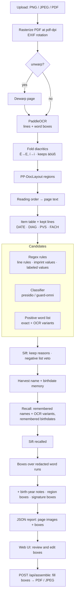

# Flow

One page on its way from upload to redacted file. Details per stage are in
[Redaction](Redaction.md).

| Stage | Where |
|---|---|
| Rasterize, EXIF | [`pdf.py`](../backend/pdf.py), [`api.py`](../backend/api.py) |
| Dewarp | [`unwarp.py`](../backend/unwarp.py) |
| OCR | [`ocr/paddle.py`](../backend/ocr/paddle.py) |
| Fold diacritics | [`textnorm.py`](../backend/textnorm.py) |
| Layout regions, reading order | [`layout.py`](../backend/layout.py) |
| Item table, kept lines | [`rules/item_table.py`](../backend/rules/item_table.py), [`rules/keep.py`](../backend/rules/keep.py) |
| Regex rules | [`rules/`](../backend/rules/) |
| Classifier | [`classifiers/`](../backend/classifiers/) |
| Word lists | [`wordlists.py`](../backend/wordlists.py) |
| Sift, boxes | [`redactor.py`](../backend/redactor.py), [`detectors.py`](../backend/detectors.py) |
| Name and birthdate memory | [`harvest.py`](../backend/harvest.py) |
| OCR variants | [`ocr_variants.py`](../backend/ocr_variants.py) |
| Report, assemble | [`service.py`](../backend/service.py) |
| Web UI | [`frontend/`](../frontend/) |
